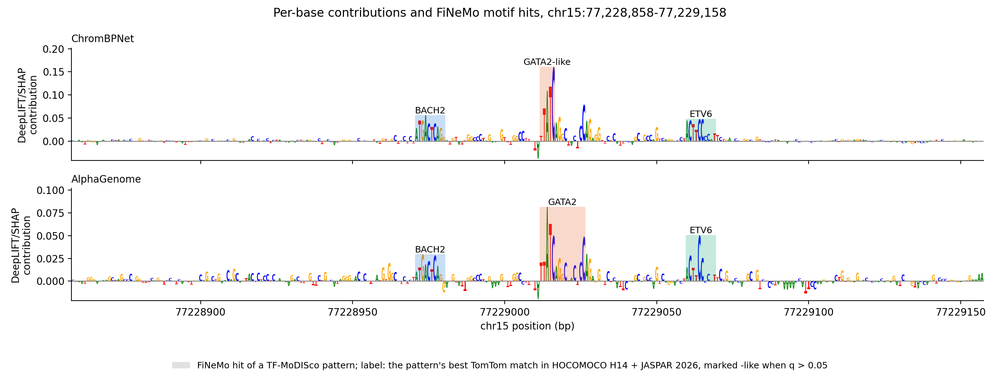

# MotifLine

A Snakemake workflow for motif discovery, hit calling and annotation from ChromBPNet and
AlphaGenome attributions. Peaks and a trained model go in; DeepLIFT/SHAP attributions,
TF-MoDISco patterns, FiNeMo hits and TomTom names come out. Both models share every stage
after attribution.

## Workflow

```text
peaks + model + genome
  -> attribute    ChromBPNet: counts head, 2,114 bp input,
                  dinucleotide-shuffled references;
                  `backend: tf` runs the official ChromBPNet code instead
                  AlphaGenome: log1p of the ATAC track summed over the central 1,000 bp,
                  `in_window` bp input (2,048 by default),
                  local dinucleotide-shuffled references
                  20 references per peak, seeded; peaks split into GPU shards
  -> discover     TF-MoDISco                          modisco/modisco.h5
  -> call hits    FiNeMo                              hits/hits.tsv
  -> name         TomTom vs HOCOMOCO H14 + JASPAR     naming/pattern_names.tsv
  -> plot         contributions and named hits over
                  the regions listed under `plots`    results/plots/<name>.png
```

## Setup and running

```bash
git clone https://github.com/wangkant/MotifLine.git && cd MotifLine
bash setup.sh
.envs/orchestration/bin/snakemake -j 32 --resources gpu=4
```

What a run uses, in workflow order. `setup.sh` installs or downloads all of it except the
ChromBPNet model, which ships with the repository.

| | what | source |
|---|---|---|
| ChromBPNet | K562 model without its bias model, Keras h5 | `weights/` in this repository |
| ChromBPNet, `backend: tf` | the official code and its DeepSHAP, chrombpnet 1.0.1 on TensorFlow 2.8 | [kundajelab/chrombpnet](https://github.com/kundajelab/chrombpnet) |
| AlphaGenome | model code with DeepLIFT rules, `64e9b75` on branch `deeplift-support` | [rastogiruchir/alphagenome-pytorch](https://github.com/rastogiruchir/alphagenome-pytorch) |
| AlphaGenome | weights, fold 0 | [gtca/alphagenome_pytorch](https://huggingface.co/gtca/alphagenome_pytorch), Google DeepMind's weights |
| DeepLIFT/SHAP | tangermeme 1.0.4 | [jmschrei/tangermeme](https://github.com/jmschrei/tangermeme) |
| TF-MoDISco | modisco-lite 2.4.0 | [jmschrei/tfmodisco-lite](https://github.com/jmschrei/tfmodisco-lite) |
| FiNeMo | 0.30 (`5c6f521`) | [austintwang/finemo_gpu](https://github.com/austintwang/finemo_gpu) |
| TomTom | MEME Suite 5.5.9 | [meme-suite.org](https://meme-suite.org) |
| HOCOMOCO | v14 CORE motifs and their annotation | [hocomoco14.autosome.org](https://hocomoco14.autosome.org) |
| JASPAR | 2026 CORE vertebrate motifs, non-redundant | [jaspar.elixir.no](https://jaspar.elixir.no) |
| Snakemake | 9.25.1 | [snakemake/snakemake](https://github.com/snakemake/snakemake) |

The AlphaGenome weights are subject to the
[AlphaGenome Model Terms](https://deepmind.google.com/science/alphagenome/model-terms).

## Outputs

Under `results/<run>/`:

| path | contents |
|---|---|
| `attr/attr.npy` | `(N, 4, W)` float32 hypothetical contribution scores; `W` = 2,114 (ChromBPNet) or `in_window` (AlphaGenome) |
| `attr/ohe.npy` | `(N, 4, W)` int8 one-hot input |
| `attr/regions.bed` | the `N` peaks, narrowPeak, in row order |
| `modisco/modisco.h5` | TF-MoDISco patterns |
| `hits/` | FiNeMo hits: `hits.tsv` per region window, `hits_unique.tsv` per genomic position |
| `naming/pattern_names.tsv` | per pattern: top three TomTom matches, `name`, its TFClass `family`, `confident` |
| `modisco_report/`, `finemo_report/` | the tools' HTML reports |

and `results/plots/<name>.png` for each entry under `plots` in the config.

Peaks whose window runs off the chromosome or contains a non-ACGT base are dropped, so
`N` can be smaller than the peak count.

## Example



300 bp of a K562 accessible region (chr15:77,228,858-77,229,158, hg38, in a PEAK1 intron)
from the example peak set, drawn by the last step of the workflow for the `example` entry
in `config/config.yaml`. The two tracks are attributed over inputs of different length,
2,114 bp for ChromBPNet and 2,048 bp for AlphaGenome, and both are cut to the same 300 bp.

## Citation

Cite MotifLine with [CITATION.cff](CITATION.cff), together with the methods and databases
your analysis used:

1. Pampari, A. et al. ChromBPNet: bias factorized, base-resolution deep learning models of
   chromatin accessibility reveal cis-regulatory sequence syntax, transcription factor
   footprints and regulatory variants. Preprint at *bioRxiv*
   https://doi.org/10.1101/2024.12.25.630221 (2024).
2. Avsec, Ž. et al. Advancing regulatory variant effect prediction with AlphaGenome.
   *Nature* **649**, 1206–1218 (2026). https://doi.org/10.1038/s41586-025-10014-0
3. Shrikumar, A., Greenside, P. & Kundaje, A. Learning important features through
   propagating activation differences. In *Proc. 34th International Conference on Machine
   Learning*, PMLR **70**, 3145–3153 (2017).
4. Schreiber, J. Tangermeme: a toolkit for understanding cis-regulatory logic using deep
   learning models. *Nat. Methods* https://doi.org/10.1038/s41592-026-03254-z (2026).
5. Shrikumar, A. et al. Technical note on transcription factor motif discovery from
   importance scores (TF-MoDISco) version 0.5.6.5. Preprint at *arXiv*
   https://arxiv.org/abs/1811.00416 (2018).
6. Wang, A. & Kundaje, A. FiNeMo, version 0.30. https://github.com/austintwang/finemo_gpu
7. Gupta, S., Stamatoyannopoulos, J. A., Bailey, T. L. & Noble, W. S. Quantifying
   similarity between motifs. *Genome Biol.* **8**, R24 (2007).
   https://doi.org/10.1186/gb-2007-8-2-r24
8. Bailey, T. L., Johnson, J., Grant, C. E. & Noble, W. S. The MEME Suite. *Nucleic Acids
   Res.* **43**, W39–W49 (2015). https://doi.org/10.1093/nar/gkv416
9. Vorontsov, I. E. et al. HOCOMOCO in 2024: a rebuild of the curated collection of binding
   models for human and mouse transcription factors. *Nucleic Acids Res.* **52**,
   D154–D163 (2024). https://doi.org/10.1093/nar/gkad1077
10. Ovek Baydar, D. et al. JASPAR 2026: expansion of transcription factor binding profiles
    and integration of deep learning models. *Nucleic Acids Res.* **54**, D184–D193 (2026).
    https://doi.org/10.1093/nar/gkaf1209
11. Mölder, F. et al. Sustainable data analysis with Snakemake. *F1000Research* **10**, 33
    (2021). https://doi.org/10.12688/f1000research.29032.2

The AlphaGenome DeepLIFT rules are Ruchir Rastogi's
([rastogiruchir/alphagenome-pytorch](https://github.com/rastogiruchir/alphagenome-pytorch),
branch `deeplift-support`).

## License

MIT; see [LICENSE](LICENSE). `scripts/ag_deeplift.py` is adapted from Apache-2.0 code;
see [NOTICE](NOTICE).
